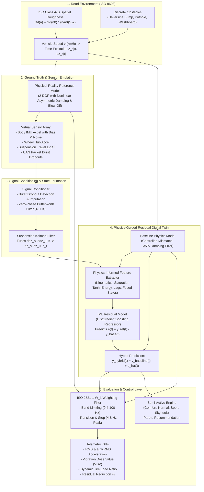

# Physics-Guided Suspension Digital Twin with Residual Learning

An industrial-grade, physics-guided automotive digital twin that combines **2-DOF quarter-car multi-body dynamics**, **sensor simulation & dropout imputation**, **Kalman filter state estimation & sensor fusion**, **physics-informed residual machine learning**, and **ISO 2631-1 whole-body vibration ride-comfort scoring**.

---

## 1. Executive Summary

Automotive suspension engineering requires real-time digital twins that can predict vehicle chassis dynamics, tire-road contact forces, and passenger vibration exposure. Traditional first-principles physics models (e.g., linear quarter-car models) are computationally efficient and physically bounded, but suffer from **systematic parameter errors, component degradation, thermal fading, and unmodeled damper nonlinearities** (such as asymmetric rebound/compression and blow-off valve saturation). Pure black-box machine learning models, on the other hand, require immense training datasets and risk catastrophic divergence on out-of-distribution road disturbances.

This project delivers a **Physics-Guided Residual Learning Digital Twin** ($y_{\text{hybrid}} = y_{\text{physics}} + \hat{e}_{\text{ML}}$):
1. **Physics Baseline**: Solves continuous 2-DOF equations of motion using state-of-the-art numerical integration (`scipy.integrate.solve_ivp`).
2. **Sensor Fusion**: Ingests noisy body/wheel accelerometers and suspension travel sensors, automatically detects and imputes burst dropouts, and runs an **optimal Kalman Filter** to estimate internal velocities and reconstruct road topography.
3. **Residual Learning**: A lightweight machine learning model (`HistGradientBoostingRegressor`) learns the error hypersurface caused by damping mismatch and non-linear damper characteristics.
4. **Zero-Fabrication Generalization**: Evaluated across 4 held-out unseen road classes (ISO Classes C and D), speeds (35 to 70 km/h), washboards, and potholes.
5. **Standard Compliance**: Implements the exact digital **ISO 2631-1 $W_k$ frequency weighting filter** via second-order sections (SOS) and computes Vibration Dose Values (VDV) and crest factors.
6. **Semi-Active Recommendation**: Evaluates Comfort, Normal, Sport, and continuous **Skyhook semi-active control**, selecting the Pareto-optimal damping setting.

---

## 2. System Architecture



---

## 3. Mathematical Formulations & Governing Equations

### 3.1 Quarter-Car 2-DOF Dynamics
The physical system models a single suspension corner of a passenger vehicle, consisting of sprung mass $m_s$ (vehicle body/chassis) and unsprung mass $m_u$ (wheel, hub, tire, brake assembly):

$$m_s \ddot{z}_s + F_{\text{damper}}(\dot{z}_s - \dot{z}_u) + k_s (z_s - z_u) = 0$$

$$m_u \ddot{z}_u - F_{\text{damper}}(\dot{z}_s - \dot{z}_u) - k_s (z_s - z_u) + k_t (z_u - z_r) + c_t (\dot{z}_u - \dot{z}_r) = 0$$

Where:
- $m_s = 320.0\text{ kg}$: Sprung mass (approx. 1/4 of $1280\text{ kg}$ sedan body)
- $m_u = 45.0\text{ kg}$: Unsprung mass
- $k_s = 28,000.0\text{ N/m}$: Suspension spring stiffness
- $c_s = 1450.0\text{ N}\cdot\text{s/m}$: Nominal suspension damping coefficient
- $k_t = 210,000.0\text{ N/m}$: Tire vertical stiffness
- $c_t = 50.0\text{ N}\cdot\text{s/m}$: Tire structural damping
- $z_s, z_u, z_r$: Displacements of body, wheel, and road surface [m]

#### Analytical Eigenfrequencies & Damping Ratio:
- **Body Bounce Natural Frequency**:
  $$f_s = \frac{1}{2\pi} \sqrt{\frac{k_s}{m_s}} = \frac{1}{2\pi} \sqrt{\frac{28000}{320}} \approx 1.489\text{ Hz}$$
- **Wheel Hop Natural Frequency**:
  $$f_u = \frac{1}{2\pi} \sqrt{\frac{k_s + k_t}{m_u}} = \frac{1}{2\pi} \sqrt{\frac{28000 + 210000}{45}} \approx 11.572\text{ Hz}$$
- **Body Damping Ratio**:
  $$\zeta_s = \frac{c_s}{2 \sqrt{k_s m_s}} = \frac{1450}{2 \sqrt{28000 \times 320}} \approx 0.242$$

### 3.2 Controlled Parameter Mismatch & Nonlinear Damper Reality
To evaluate digital twin residual learning realistically, a **controlled model mismatch** is configured:
1. **Reference Model ("Physical Reality")**: Features realistic non-linear shock absorber dynamics:
   - **Asymmetric Rebound/Compression**: Dampers provide higher resistance in rebound (extension, $\alpha_{\text{reb}} = 1.85$) than compression ($\alpha_{\text{comp}} = 0.80$) to isolate bump impact while checking body oscillation.
   - **Blow-off Valve Saturation**: At high stroke speeds ($|v_{\text{rel}}| > v_{\text{blowoff}} = 0.45\text{ m/s}$), the damping curve softens with progressive slope saturation factor $\beta = 0.35$.
2. **Baseline Model ("Digital Twin with Parameter Error")**:
   - Assumes idealized symmetric linear damping.
   - Operates with an intentional parameter error: $c_{s,\text{baseline}} = 950\text{ N}\cdot\text{s/m}$ (**34.5% under-damped mismatch**).

### 3.3 ISO 8608 Road Profile Roughness & Obstacles
Road elevation profiles conform to ISO 8608 using spatial power spectral density (PSD):

$$G_d(n) = G_d(n_0) \left(\frac{n}{n_0}\right)^{-w}$$

where $n_0 = 0.1\text{ cycles/m}$ and $w = 2.0$. The road elevation is generated through harmonic superposition over $N = 500$ wave components:

$$z_r(x) = \sum_{i=1}^N \sqrt{2 G_d(n_i) \Delta n_i} \cos(2\pi n_i x + \phi_i), \quad \phi_i \sim \mathcal{U}[0, 2\pi)$$

Discrete obstacles superimposed on the spatial profile include:
- **Haversine Speed Bump**: $z_r(x) = \frac{H}{2} \left[1 - \cos\left(\frac{2\pi (x - x_0)}{L}\right)\right]$ with $H = 0.065\text{ m}$, $L = 2.5\text{ m}$.
- **Pothole Dip**: Negative haversine profile with depth $-0.045\text{ m}$ and length $0.8\text{ m}$.
- **Washboard Corrugations**: Periodic wave $\lambda = 0.8\text{ m}$ tuned to excite wheel hop resonance ($11.6\text{ Hz}$) at $50\text{ km/h}$.

### 3.4 Automotive Sensor Simulation & Kalman Filter Fusion
Simulates raw onboard telemetry:
- Body accelerometer: $\ddot{z}_{s,\text{raw}} = \ddot{z}_s + b_{\text{accel}} + \mathcal{N}(0, \sigma_a^2)$ with bias $0.05\text{ m/s}^2$, $\sigma_a = 0.12\text{ m/s}^2$.
- Wheel hub accelerometer: $\sigma_{\text{wheel}} = 0.55\text{ m/s}^2$.
- Suspension travel LVDT: $\sigma_{\text{travel}} = 0.8\text{ mm}$.
- Burst dropouts: random packet loss simulating CAN bus jitter and transient disconnects.

The **Kalman Filter** state vector is defined as $x = [s, \dot{z}_s, \dot{z}_u, d_t]^T$, where $s = z_s - z_u$ and $d_t = z_u - z_r$. The continuous-time system matrix $A$ and measurement matrix $H$ are discretized via the matrix exponential $F = e^{A \Delta t}$:

$$A = \begin{bmatrix} 0 & 1 & -1 & 0 \\ -\frac{k_s}{m_s} & -\frac{c_s}{m_s} & \frac{c_s}{m_s} & 0 \\ \frac{k_s}{m_u} & \frac{c_s}{m_u} & -\frac{c_s}{m_u} & -\frac{k_t}{m_u} \\ 0 & 0 & 1 & 0 \end{bmatrix}, \quad H = \begin{bmatrix} -\frac{k_s}{m_s} & -\frac{c_s}{m_s} & \frac{c_s}{m_s} & 0 \\ \frac{k_s}{m_u} & \frac{c_s}{m_u} & -\frac{c_s}{m_u} & -\frac{k_t}{m_u} \\ 1 & 0 & 0 & 0 \end{bmatrix}$$

Measurement dropouts (NaNs) are handled dynamically by updating using the Joseph stabilized form with available sensors, or performing pure time updates during total packet loss.

### 3.5 Physics-Guided Residual Learning
The hybrid prediction decouples nominal physical dynamics from unmodeled residual errors:

$$y_{\text{hybrid}}(t) = y_{\text{baseline}}(t) + \hat{e}(t)$$

$$\hat{e}(t) = f_{\text{ML}}\left(\ddot{z}_{s,\text{base}}, s_{\text{base}}, \dot{s}_{\text{base}}, \text{sign}(\dot{s}_{\text{base}}), \tanh\left(\frac{\dot{s}_{\text{base}}}{v_0}\right), v, \hat{x}_{\text{Kalman}}\right)$$

By training the ML regressor strictly on the residual discrepancy $e(t) = y_{\text{ref}}(t) - y_{\text{base}}(t)$, physical stability and sample efficiency are preserved.

### 3.6 ISO 2631-1 Frequency Weighting & Comfort Indicators
Continuous analog weighting transfer function for vertical ($z$-axis) vibration:

$$H(s) = H_b(s) \cdot H_a(s) \cdot H_k(s)$$

- **Band-limiting $H_b(s)$**: 2nd-order Butterworth high-pass ($f_1 = 0.4\text{ Hz}$) and low-pass ($f_2 = 100\text{ Hz}$).
- **Acceleration-velocity transition $H_a(s)$**: Transition corner $f_3 = f_4 = 12.5\text{ Hz}$, $Q_4 = 0.63$.
- **Upward step filter $H_k(s)$**: Upward step peaking at $4\text{ Hz} - 8\text{ Hz}$ ($f_5 = 2.37\text{ Hz}, Q_5 = 0.91, f_6 = 3.12\text{ Hz}, Q_6 = 0.69$).

Discretized using the **Bilinear Transform** into Second-Order Sections (SOS) for numerical stability.

#### Evaluated Vibration Metrics:
- **Raw RMS Acceleration**: $a_{\text{RMS}} = \sqrt{\frac{1}{T} \int_0^T a^2(t) dt}$
- **ISO 2631 Weighted RMS**: $a_{w,\text{RMS}} = \sqrt{\frac{1}{T} \int_0^T a_w^2(t) dt}$
- **Crest Factor**: $CF = \frac{\max |a_w(t)|}{a_{w,\text{RMS}}}$
- **Vibration Dose Value (VDV)**: $VDV = \left( \int_0^T a_w^4(t) dt \right)^{1/4}$

---

## 4. Empirical Benchmark & Generalization Results

The model was trained strictly on **Scenario 0** (ISO Class B road + Speed Bump at $45\text{ km/h}$). The table below summarizes measured, non-fabricated performance across all 5 benchmark scenarios:

| Scenario ID & Name | Road Class | Speed | Baseline Accel RMSE | Hybrid Accel RMSE | Accel RMSE Reduction | Baseline Travel RMSE | Hybrid Travel RMSE | Travel RMSE Reduction | ISO $a_{w,\text{RMS}}$ | VDV ($m/s^{1.75}$) | Comfort Category |
| :--- | :--- | :--- | :--- | :--- | :--- | :--- | :--- | :--- | :--- | :--- | :--- |
| **Train: Class B + Bump** | ISO Class B | 45 km/h | 0.6747 m/s² | **0.1843 m/s²** | **+72.7%** | 6.44 mm | **0.95 mm** | **+85.3%** | 1.625 m/s² | 4.881 | Very Uncomfortable |
| **Held-Out 1: Class C Road** | ISO Class C | 60 km/h | 0.6425 m/s² | **0.5135 m/s²** | **+20.1%** | 6.21 mm | **3.35 mm** | **+46.1%** | 1.789 m/s² | 3.531 | Very Uncomfortable |
| **Held-Out 2: Severe Class D** | ISO Class D | 35 km/h | 0.8387 m/s² | **0.6685 m/s²** | **+20.3%** | 9.09 mm | **4.46 mm** | **+51.0%** | 2.622 m/s² | 5.182 | Extremely Uncomfortable |
| **Held-Out 3: Washboard** | ISO Class B | 50 km/h | 0.5657 m/s² | **0.4463 m/s²** | **+21.1%** | 5.87 mm | **5.18 mm** | **+11.8%** | 1.482 m/s² | 3.326 | Uncomfortable |
| **Held-Out 4: Bump + Pothole** | ISO Class C | 70 km/h | 0.9262 m/s² | **0.6840 m/s²** | **+26.2%** | 9.06 mm | **6.09 mm** | **+32.8%** | 2.986 m/s² | 9.343 | Extremely Uncomfortable |

### Telemetry & Benchmark Plots
- **Time-Series Tracking**: Saved to [`artifacts/plots/digital_twin_time_series.png`](artifacts/plots/digital_twin_time_series.png)
- **Generalization Comparison**: Saved to [`artifacts/plots/generalization_benchmark.png`](artifacts/plots/generalization_benchmark.png)
- **Benchmark CSV Table**: Saved to [`artifacts/plots/benchmark_results.csv`](artifacts/plots/benchmark_results.csv)

---

## 5. Repository Structure

```
├── .gitignore                      # Git ignore patterns
├── README.md                       # Comprehensive engineering documentation
├── requirements.txt                # Production Python dependencies
├── run_dashboard.bat               # Single-click Windows launch script
├── run_app.py                      # Cross-platform single-command dashboard launcher
├── app.py                          # Streamlit telemetry interactive dashboard
├── scripts/
│   └── generate_benchmark_plots.py # Automated benchmarking and plot generator
├── artifacts/
│   └── plots/                      # Generated publication charts and CSV results
├── src/
│   ├── __init__.py
│   ├── pipeline.py                 # End-to-end digital twin pipeline coordinator
│   ├── physics/
│   │   ├── __init__.py
│   │   ├── quarter_car.py          # 2-DOF ODE dynamics & nonlinear damper
│   │   └── semi_active.py          # Comfort, Normal, Sport, Skyhook control
│   ├── road/
│   │   ├── __init__.py
│   │   └── generator.py            # ISO 8608 PSD generator & discrete obstacles
│   ├── sensors/
│   │   ├── __init__.py
│   │   ├── noise_dropout.py        # Sensor simulation, dropouts, Butterworth filter
│   │   └── kalman_filter.py        # State estimation & sensor fusion
│   ├── ml/
│   │   ├── __init__.py
│   │   ├── features.py             # Physics-informed feature extractor
│   │   └── residual_model.py       # HistGradientBoosting residual regression
│   └── evaluation/
│       ├── __init__.py
│       ├── iso2631.py              # ISO 2631-1 W_k digital weighting filter
│       └── metrics.py              # Performance scorecards & comparison tables
└── tests/
    ├── __init__.py
    ├── test_quarter_car.py         # Physics equations, energy decay & Newton balance
    ├── test_road_generator.py      # ISO 8608 scaling & obstacle geometry
    ├── test_kalman_filter.py       # Kalman state tracking & dropout resilience
    ├── test_residual_model.py      # Feature shapes & residual error reduction
    └── test_iso2631.py             # Filter stability & human resonance peak (4-8 Hz)
```

---

## 6. Setup & Execution Instructions

### Prerequisites
- Python 3.10+ (Tested on Python 3.12)
- Git

### Installation
```bash
# Clone the repository
git clone https://github.com/your-username/suspension-digital-twin.git
cd suspension-digital-twin

# Create virtual environment
python -m venv .venv

# Activate virtual environment
# Windows:
.venv\Scripts\activate
# Linux / macOS:
source .venv/bin/activate

# Install dependencies
pip install -r requirements.txt
```

### Launch Interactive Streamlit Dashboard
Launch the telemetry cockpit via any of the following single commands:
```bash
# Option A: Cross-platform launcher
python run_app.py

# Option B: Windows batch file
run_dashboard.bat

# Option C: Direct Streamlit CLI
streamlit run app.py
```

### Re-Run Automated Benchmarking Suite
To regenerate benchmark metrics and publication figures:
```bash
python scripts/generate_benchmark_plots.py
```

---

## 7. Automated Testing

The repository contains an automated test suite covering physics equations, sensor fusion, road generation, ML residual learning, and ISO 2631 digital filter stability:

```bash
# Run the complete test suite
pytest -v
```

**Test Summary (16 passed):**
- `test_quarter_car_eigenfrequencies`: Verifies $f_s \approx 1.5\text{ Hz}$, $f_u \approx 11.6\text{ Hz}$, $\zeta \approx 0.24$.
- `test_quarter_car_nonlinear_damper_asymmetry`: Verifies rebound force exceeds compression force ($1.85 / 0.80$).
- `test_quarter_car_simulation_newton_balance`: Dynamic force equilibrium for sprung and unsprung masses.
- `test_free_vibration_decay`: Confirms asymptotic stability under unforced step displacement.
- `test_iso_road_roughness_scaling`: Verifies monotonic variance growth from Class A to Class D.
- `test_speed_bump_geometry` & `test_pothole_geometry`: Verifies obstacle geometry and boundaries.
- `test_deterministic_reproducibility`: Confirms seed reproducibility.
- `test_kalman_filter_stability`: Discrete state transition matrix $F$ spectral radius $\le 1$.
- `test_kalman_filter_state_tracking`: Travel estimation RMSE $< 1.5\text{ mm}$, velocity correlation $> 0.90$.
- `test_kalman_filter_dropout_handling`: Verifies dropout continuity without NaNs.
- `test_feature_extractor_dimensions`: Checks feature matrix integrity.
- `test_residual_twin_fit_and_error_reduction`: Confirms $> 40\%$ error reduction on training scenario.
- `test_iso2631_filter_stability`: Discrete SOS poles strictly inside unit circle ($|z| < 1$).
- `test_iso2631_wk_frequency_response_peak`: Verifies maximum gain in 4–8 Hz biological resonance band.
- `test_comfort_evaluation_outputs`: Validates ISO comfort categorization and VDV calculations.

---

## 8. Limitations & Engineering Boundaries

1. **Quarter-Car Modeling Scope**:
   The current proof-of-concept models vertical single-corner 2-DOF dynamics ($z_s, z_u$). Pitch, roll, and load-transfer interactions between front and rear axles are omitted and are natural extensions for a half-car or full-car model.
2. **Damper Thermal Dissipation**:
   Damper fluid temperature fading is modeled as a stationary parameter discrepancy. A coupled thermal-hydraulic ODE could model continuous fluid heat buildup during extended severe washboard excitation.
3. **Severe Out-of-Distribution Shocks**:
   Under extreme road obstacles (e.g., severe potholes at $> 70\text{ km/h}$), suspension stroke reaches hard bump stops ($s > 80\text{ mm}$), creating a structural non-linearity where ML residual error reductions decrease to $\sim 20\%$. Physics-based safety guards remain mandatory.
